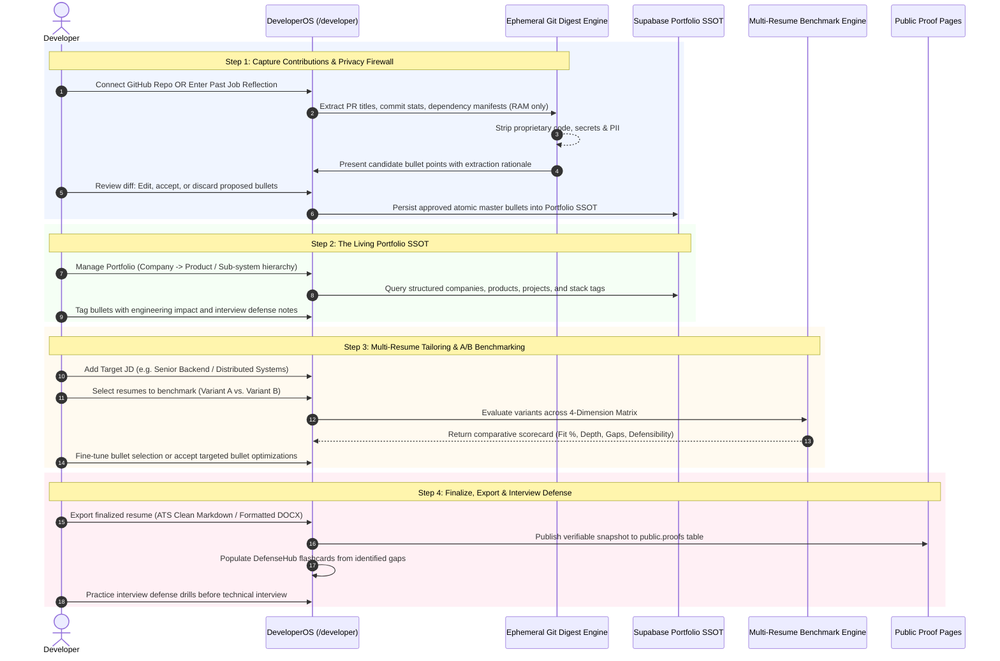
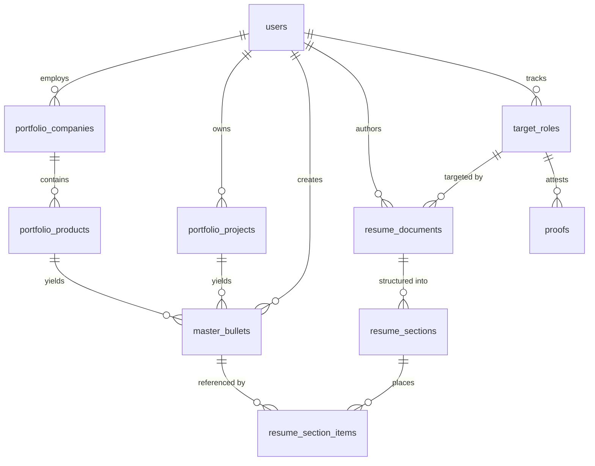
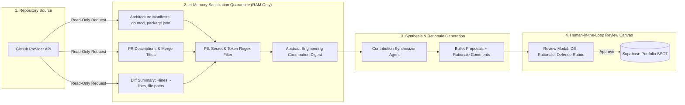
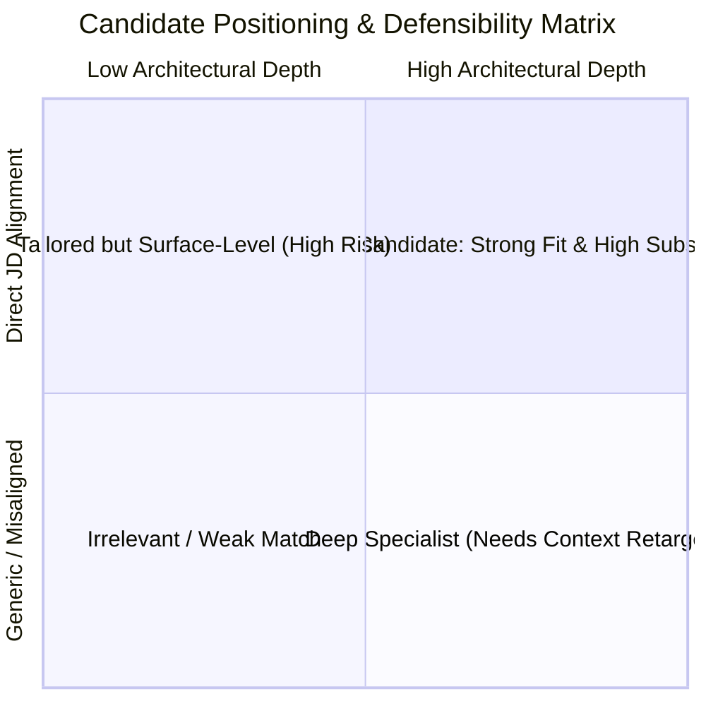
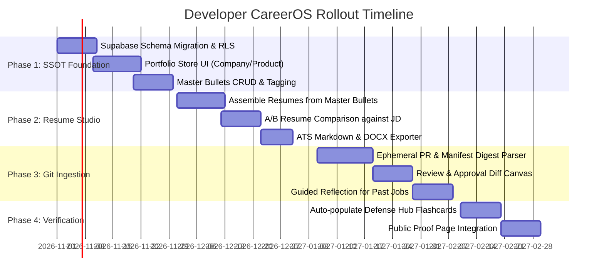

# GitGrill Developer CareerOS: Portfolio SSOT & Multi-Resume Studio Architecture Spec

> **Document Version:** v1.0 · October 2026  
> **Status:** Architecture Blueprint & Non-Breaking Database RFC  
> **Target System:** Developer CareerOS Workspace (`/developer`), Supabase Database & Migration Layer  
> **Companion Documents:** `MONETIZATION_ARCHITECTURE.md`, `DEVELOPER_CAREER_OS_IDEATION.md`, `SUPER_ADMIN_AND_DEVELOPER_LIMITS_SPEC.md`

---

## 1. Executive Summary & Problem Analysis

Traditional resume builders treat resumes as static `.docx`/`.pdf` text files. For software engineers, this creates four structural failures:

1. **The Contribution Articulation Gap:** Day-to-day engineering breakthroughs (race conditions solved, p99 latency cut, database failover designed) flatten into generic, uninspired resume lines (*"Built API endpoints with Node.js"*).
2. **The Fragmented Work History Problem:** Over years across multiple companies and side projects, achievements and metrics scatter. There is no Single Source of Truth (SSOT) where a developer logs their companies, products owned, tech stacks, and concrete achievements.
3. **The Manual Tailoring Burnout:** When applying to diverse roles (e.g., *High-Throughput Distributed Systems* vs. *Product Velocity Lead*), developers manually duplicate and tweak disconnected files, losing track of which resume has which bullet and second-guessing which variant is strongest.
4. **The "Black Box" Resume vs. Interview Reality:** Superficial keyword tailoring creates inflated claims that collapse when an interviewer digs into implementation details. Contributions must stay rooted in real artifacts (PRs, diffs, architectural trade-offs) so the developer can defend every claim with confidence.

### The Solution: Decoupling SSOT from Presentation
Developer CareerOS decouples the developer's career into two layers:
- **The Living Portfolio Store (SSOT):** A structured, persistent relational repository organized by **Company → Product/Sub-system** and **Standalone Projects**, enriched by privacy-preserving repository digests.
- **The Multi-Resume Presentation Studio:** Resumes become dynamic views composed from the SSOT, tailored to emphasize specific paradigms, benchmarked side-by-side against target JDs, and backed by verifiable proof links.

---

## 2. Non-Breaking Database Safety Contract

To ensure that introducing the Portfolio SSOT **never breaks, alters, or destabilizes our existing database setup**, this specification strictly adheres to zero-downtime, non-destructive migration rules.

### 2.1 Audit of Existing Supabase Tables (Live Schema Preservation)

| Existing Table | Primary Key | Critical Foreign Keys | Safety Guarantee |
| :--- | :--- | :--- | :--- |
| `public.users` | `id uuid` | Self-contained (auth mirror) | **Untouched.** Never dropped, altered, or truncated. All new portfolio tables reference `users(id) on delete cascade`. |
| `public.target_roles` | `id text` | `user_id uuid -> users(id)` | **Preserved.** Target roles remain the core of the application Kanban. Resumes optionally reference `target_roles(id)` via `text` foreign key. |
| `public.defense_cards` | `id text` | `user_id uuid -> users(id)` | **Preserved.** Practice flashcards continue functioning with spaced repetition. |
| `public.proofs` | `id text` | `username text, role_id text` | **Preserved.** Public shareable proof snapshots retain their public-read RLS policies. |
| `public.workspaces` | `id uuid` | `owner_user_id uuid -> users(id)`| **Untouched.** Recruiter multi-tenant isolation remains intact. |
| `public.usage_events` | `id uuid` | `user_id uuid -> users(id)` | **Untouched.** Quota ledger and audit counts remain unaffected. |

### 2.2 Schema Layering Principle (100% Additive)
1. **Zero Destructive DDL:** No `DROP TABLE`, no `DROP COLUMN`, no `ALTER COLUMN TYPE` on existing relations.
2. **Strict Foreign Key Type Alignment:** `resume_documents.target_role_id` is typed as `text references public.target_roles(id) on delete set null`, perfectly matching the text ID format of `target_roles` without type mismatches.
3. **Idempotence:** Every statement uses `CREATE TABLE IF NOT EXISTS`, `CREATE INDEX IF NOT EXISTS`, and `DROP POLICY IF EXISTS ...; CREATE POLICY ...`.

---

## 3. End-to-End System & User Flow



---

## 4. Entity Architecture & Supabase DDL



### Production DDL Migration (`portfolio-migration.sql`)

```sql
-- ==============================================================================
-- GitGrill Developer CareerOS: Living Portfolio & Resume Studio Migration
-- 100% Non-Breaking & Additive: Layered on top of existing users & target_roles
-- ==============================================================================

-- 1. Companies / Organizations
create table if not exists public.portfolio_companies (
  id uuid primary key default gen_random_uuid(),
  user_id uuid not null references public.users(id) on delete cascade,
  name text not null,
  location text,
  website_url text,
  start_date date not null,
  end_date date, -- null indicates current employer
  is_current boolean not null default false,
  display_order integer not null default 0,
  created_at timestamptz not null default now(),
  updated_at timestamptz not null default now()
);

-- 2. Products / Sub-systems owned within a company
create table if not exists public.portfolio_products (
  id uuid primary key default gen_random_uuid(),
  company_id uuid not null references public.portfolio_companies(id) on delete cascade,
  user_id uuid not null references public.users(id) on delete cascade,
  title text not null, -- e.g. "Core Settlement Engine"
  role_title text not null, -- e.g. "Senior Backend Engineer"
  description text,
  tech_stack text[] not null default '{}',
  architectural_notes text, -- Trade-offs, scale, latency requirements
  repo_links jsonb not null default '[]'::jsonb, -- [{ "name": "org/repo", "is_private": true }]
  display_order integer not null default 0,
  created_at timestamptz not null default now(),
  updated_at timestamptz not null default now()
);

-- 3. Standalone / Open-Source / Client Projects
create table if not exists public.portfolio_projects (
  id uuid primary key default gen_random_uuid(),
  user_id uuid not null references public.users(id) on delete cascade,
  name text not null,
  headline text,
  live_url text,
  repo_url text,
  is_private boolean not null default false,
  tech_stack text[] not null default '{}',
  architectural_highlights text,
  display_order integer not null default 0,
  created_at timestamptz not null default now(),
  updated_at timestamptz not null default now()
);

-- 4. Atomic Master Bullets (The SSOT Contribution Ledger)
create table if not exists public.master_bullets (
  id uuid primary key default gen_random_uuid(),
  user_id uuid not null references public.users(id) on delete cascade,
  product_id uuid references public.portfolio_products(id) on delete cascade,
  project_id uuid references public.portfolio_projects(id) on delete cascade,
  
  bullet_text text not null,
  action_verb text,
  impact_metric text, -- e.g. "reduced p99 latency by 34%"
  primary_skills text[] not null default '{}',
  
  -- Provenance & Human Review
  source_type text not null default 'manual' check (source_type in ('manual', 'git_digest', 'docx_import', 'ai_synthesized')),
  source_evidence jsonb, -- { "pr_number": 42, "rationale": "Extracted from Redis caching implementation" }
  review_status text not null default 'approved' check (review_status in ('pending_review', 'approved', 'rejected', 'archived')),
  
  -- Defensibility context for technical interviews
  interview_rubric jsonb, -- { "likely_probe": "How did you prevent cache stampedes?", "defense_key": "Implemented singleflight mutex locks" }
  
  created_at timestamptz not null default now(),
  updated_at timestamptz not null default now(),
  constraint chk_bullet_parent check (
    (product_id is not null and project_id is null) or
    (product_id is null and project_id is not null) or
    (product_id is null and project_id is null)
  )
);

-- 5. Multi-Resume Document Registry
create table if not exists public.resume_documents (
  id text primary key, -- e.g. "res_backend_staff_v1"
  user_id uuid not null references public.users(id) on delete cascade,
  target_role_id text references public.target_roles(id) on delete set null,
  
  title text not null, -- e.g. "Distributed Systems Master (v2.1)"
  variant_tag text not null default 'general' check (variant_tag in ('general', 'backend', 'fullstack', 'platform', 'lead', 'tailored')),
  is_master_template boolean not null default false,
  
  -- Header & Contact Information
  full_name text not null,
  headline text,
  contact_email text not null,
  phone text,
  location text,
  github_url text,
  linkedin_url text,
  portfolio_url text,
  summary text,
  
  -- Render Configuration
  layout_config jsonb not null default '{"show_metrics_first": true, "bullets_per_job": 4}'::jsonb,
  ats_score integer,
  
  created_at timestamptz not null default now(),
  updated_at timestamptz not null default now()
);

-- 6. Resume Sections & Ordered Item Placements
create table if not exists public.resume_sections (
  id uuid primary key default gen_random_uuid(),
  resume_id text not null references public.resume_documents(id) on delete cascade,
  section_type text not null check (section_type in ('summary', 'experience', 'projects', 'skills', 'education', 'custom')),
  title text not null,
  display_order integer not null,
  custom_content text
);

create table if not exists public.resume_section_items (
  id uuid primary key default gen_random_uuid(),
  section_id uuid not null references public.resume_sections(id) on delete cascade,
  bullet_id uuid references public.master_bullets(id) on delete set null,
  tailored_bullet_text text,
  display_order integer not null,
  is_included boolean not null default true
);

-- === Indexes ===
create index if not exists idx_portfolio_companies_user on public.portfolio_companies (user_id);
create index if not exists idx_portfolio_products_company on public.portfolio_products (company_id);
create index if not exists idx_master_bullets_user on public.master_bullets (user_id);
create index if not exists idx_master_bullets_skills on public.master_bullets using gin(primary_skills);
create index if not exists idx_resume_documents_user on public.resume_documents (user_id);
create index if not exists idx_resume_documents_role on public.resume_documents (target_role_id);

-- === Row Level Security (RLS) Policies ===
alter table public.portfolio_companies enable row level security;
alter table public.portfolio_products enable row level security;
alter table public.portfolio_projects enable row level security;
alter table public.master_bullets enable row level security;
alter table public.resume_documents enable row level security;
alter table public.resume_sections enable row level security;
alter table public.resume_section_items enable row level security;

-- Owner data isolation (User <-> User Red Line)
drop policy if exists "portfolio_companies_owner_all" on public.portfolio_companies;
create policy "portfolio_companies_owner_all" on public.portfolio_companies for all using (auth.uid() = user_id);

drop policy if exists "portfolio_products_owner_all" on public.portfolio_products;
create policy "portfolio_products_owner_all" on public.portfolio_products for all using (auth.uid() = user_id);

drop policy if exists "portfolio_projects_owner_all" on public.portfolio_projects;
create policy "portfolio_projects_owner_all" on public.portfolio_projects for all using (auth.uid() = user_id);

drop policy if exists "master_bullets_owner_all" on public.master_bullets;
create policy "master_bullets_owner_all" on public.master_bullets for all using (auth.uid() = user_id);

drop policy if exists "resume_documents_owner_all" on public.resume_documents;
create policy "resume_documents_owner_all" on public.resume_documents for all using (auth.uid() = user_id);

drop policy if exists "resume_sections_owner_all" on public.resume_sections;
create policy "resume_sections_owner_all" on public.resume_sections for all using (
  exists (select 1 from public.resume_documents r where r.id = resume_sections.resume_id and r.user_id = auth.uid())
);

drop policy if exists "resume_section_items_owner_all" on public.resume_section_items;
create policy "resume_section_items_owner_all" on public.resume_section_items for all using (
  exists (
    select 1 from public.resume_sections s
    join public.resume_documents r on r.id = s.resume_id
    where s.id = resume_section_items.section_id and r.user_id = auth.uid()
  )
);
```

---

## 5. Ephemeral Ingestion & Privacy Protocol (NDA & Proprietary Code)

Enterprise developers write code under non-disclosure agreements. Storing private source code or raw commit files is a security violation. GitGrill operates on an **Ephemeral Git Digest** paradigm:



### 5.1 Protocol Rules
1. **Never Clone, Never Store Code:** The backend never writes private source files to disk or database. Only high-level diff metadata and manifests are analyzed ephemerally in RAM.
2. **Deterministic Sanitization:** Internal hostnames, AWS bucket names, customer IDs, and database connection strings are purged via regex masks before hitting the synthesis model.
3. **Handling Past Companies Without Repo Access:**
   - Developers utilize a **Guided Reflection Interviewer**: They provide unstructured notes (*"At Stripe, I worked on the idempotent refund engine"*).
   - The agent probes for architectural trade-offs: *"Did you use distributed lock leases or database unique keys? What was the retry volume?"*
   - Produces structured, metric-grounded bullet proposals ready for manual verification.

### 5.2 Human-in-the-Loop Review Canvas
Suggested additions or edits never silently enter the developer's SSOT. The developer reviews a diff card displaying:
- **Original Context:** PR title, merge description, or developer reflection.
- **Synthesized Bullet:** Action-verb + architectural object + quantifiable outcome formula.
- **Transparent Rationale:** Explicit reason why this bullet was formulated.
- **Interview Defense Key:** High-probability interviewer question and how to defend the claim.

---

## 6. Multi-Resume Benchmark & A/B Positioning Engine

Rather than rewarding superficial keyword stuffing, the benchmarking engine evaluates resumes against target JDs across **four objective dimensions**:



### 6.1 The 4-Dimension Evaluation Matrix

| Dimension | Weight | Measurement Objective | Evaluation Method |
| :--- | :--- | :--- | :--- |
| **1. Direct JD Alignment** | 35% | Direct coverage of mandatory requirements, seniority expectations, and tech stacks. | Cross-references skills & experience bullets against JD responsibilities. |
| **2. Architectural Depth & Scale** | 30% | Metric density, scale indicators, trade-off clarity, and ownership scope. | Measures action verb strength, numerical impact (`ms`, `req/s`, `users`), and system complexity. |
| **3. Transferrable Competencies** | 20% | Adjacent paradigm and technology capability (e.g., Kafka ↔ RabbitMQ, GCP ↔ AWS). | Graph-based taxonomy match preventing false-negative penalties. |
| **4. Interview Defensibility Index** | 15% | Whether claims are backed by public repository evidence and clear trade-off narratives. | Corroborates claims against verified proof artifacts in [`public.proofs`](file:///e:/rabby-xponent/Projects/devscope/backend/src/proofs/proof-store.ts). |

---

## 7. Phased Implementation Roadmap



- **Phase 1: The Living Portfolio SSOT (Manual Entry First) — [COMPLETED ✅]**
  - **Database DDL Executed & Verified:** Live migration executed in Supabase SQL editor via [`backend/src/auth/portfolio-migration.sql`](file:///e:/rabby-xponent/Projects/devscope/backend/src/auth/portfolio-migration.sql). Verified 7 tables with zero regression to existing tables:
    * `portfolio_companies`
    * `portfolio_products`
    * `portfolio_projects`
    * `master_bullets`
    * `resume_documents`
    * `resume_sections`
    * `resume_section_items`
  - **Backend API Deployed:** Created [`backend/src/portfolio/portfolio.routes.ts`](file:///e:/rabby-xponent/Projects/devscope/backend/src/portfolio/portfolio.routes.ts) and mounted at `/api/portfolio` in [`backend/src/index.ts`](file:///e:/rabby-xponent/Projects/devscope/backend/src/index.ts):
    * `GET /api/portfolio`: Full company/product/bullet hierarchy query.
    * `POST /api/portfolio/companies` & `DELETE /api/portfolio/companies/:id`
    * `POST /api/portfolio/products` & `DELETE /api/portfolio/products/:id`
    * `POST /api/portfolio/projects` & `DELETE /api/portfolio/projects/:id`
    * `POST /api/portfolio/bullets` & `DELETE /api/portfolio/bullets/:id`
    * `POST /api/portfolio/bootstrap-from-resume`: 1-click import from Resume Vault.
  - **Frontend Client & UI Layer:**
    * Created [`frontend/lib/portfolio.ts`](file:///e:/rabby-xponent/Projects/devscope/frontend/lib/portfolio.ts): Strongly typed SSOT client with automatic offline/guest fallback.
    * Built [`frontend/components/PortfolioHub.tsx`](file:///e:/rabby-xponent/Projects/devscope/frontend/components/PortfolioHub.tsx): Living Portfolio SSOT workspace with company hierarchy, product architectures, master bullets with quantifiable metric highlights, expandable technical trade-off drawers, and 1-click resume import modal.
    * Mounted tab in [`frontend/app/developer/page.tsx`](file:///e:/rabby-xponent/Projects/devscope/frontend/app/developer/page.tsx).
    * Enhanced [`frontend/components/icons.tsx`](file:///e:/rabby-xponent/Projects/devscope/frontend/components/icons.tsx) with `Trash` and `ExternalLink` icons.
  - **Verification:** Both backend and frontend compiled with 0 errors (`npx tsc --noEmit`).

- **Phase 2: Multi-Resume Studio & A/B JD Benchmarking — [NEXT UP 🚀]**
  - Compose dynamic resume variants by tagging and assembling master bullets.
  - Multi-Resume Benchmarking in [`JDResumeMatchmaker.tsx`](file:///e:/rabby-xponent/Projects/devscope/frontend/components/JDResumeMatchmaker.tsx) showing comparative scorecards.
  - ATS-compliant Markdown and styled DOCX export.
- **Phase 3: Ephemeral Git Digest Engine & Human Review Canvas**
  - GitHub PR/Manifest metadata fetcher with zero code storage.
  - Human-in-the-loop review modal with visual rationale and interview defensibility keys.
  - Guided architectural reflection for past positions where repository access is lost.
- **Phase 4: End-to-End Interview Defense & Proof Attestation**
  - Automatic synchronization between unverified resume claims and [`DefenseHub.tsx`](file:///e:/rabby-xponent/Projects/devscope/frontend/components/DefenseHub.tsx) flashcards.
  - Direct integration between finalized resumes and public proof links ([`/proof/:username/:roleId`](file:///e:/rabby-xponent/Projects/devscope/backend/src/proofs/proof.routes.ts)).
